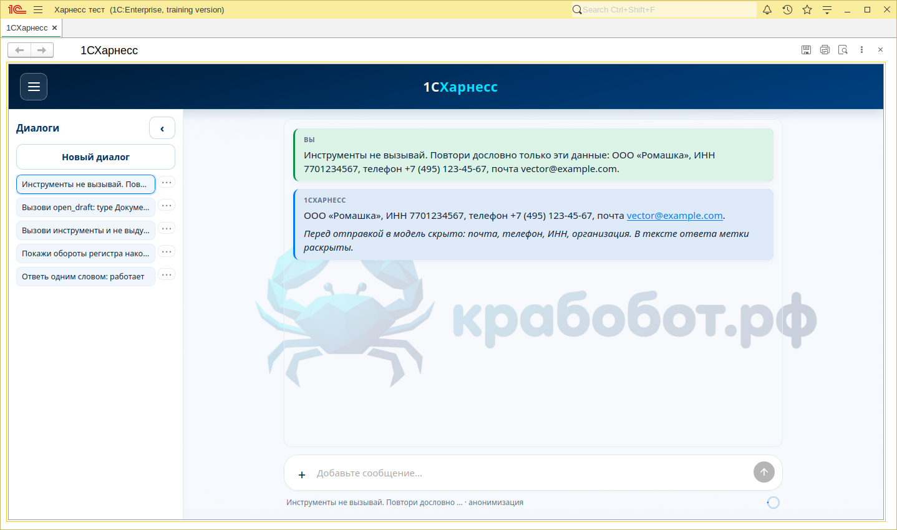
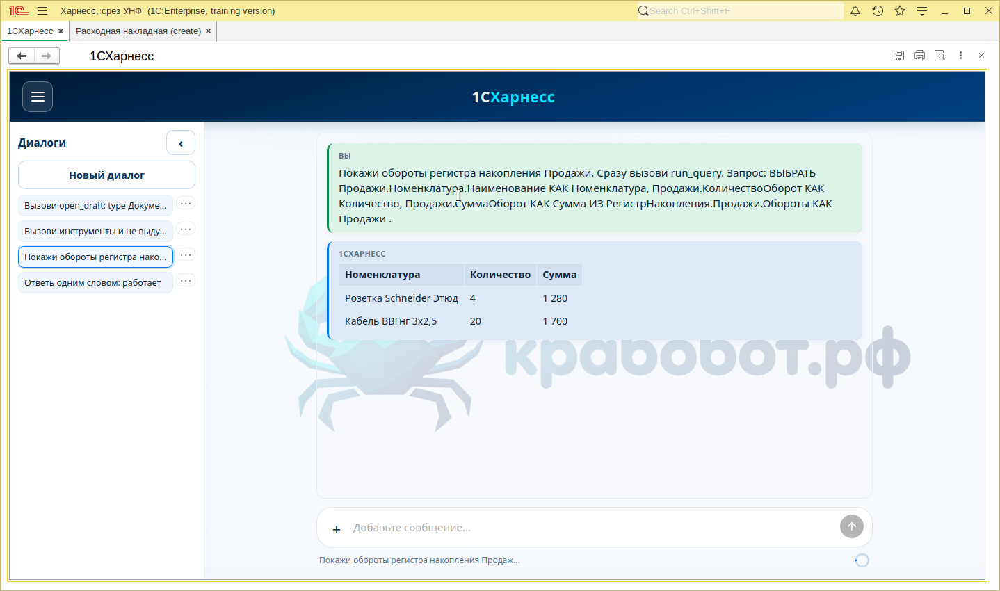
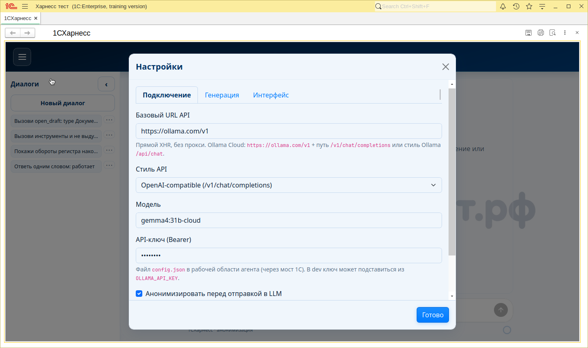
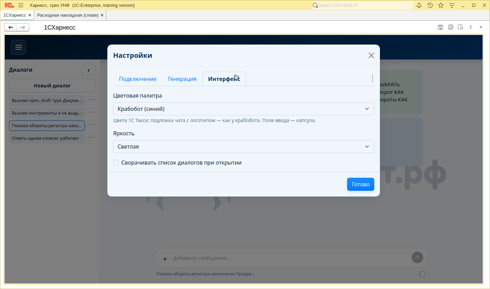
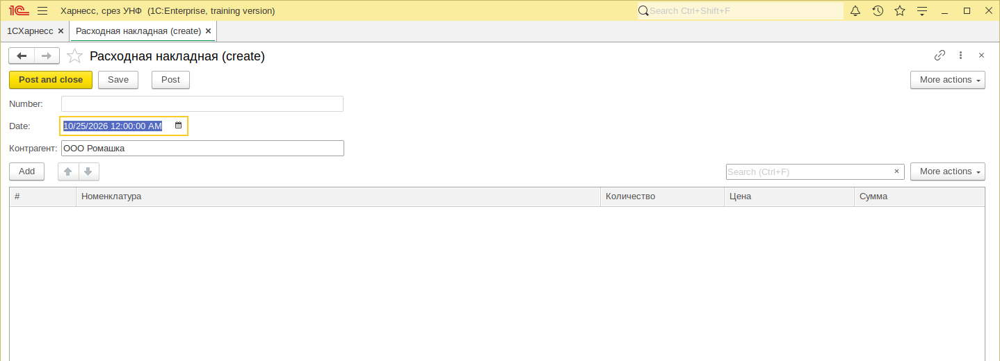

# 1СХарнесс

Чат-агент для 1С. Страница собрана по образцу [крабобот](https://github.com/andretisch/krabobot): шапка, список диалогов, пузыри ответов и подложка с логотипом. Строка ввода — капсула. В меню две палитры, «Крабобот (синий)» и «1С Такси (шахматка)»; подложка с крабом остаётся на обеих.

## Что в репозитории

- [`index.html`](index.html) — один файл чата. Стили, скрипты и логотип уже внутри.
- [`epf/1CHarness.epf`](epf/1CHarness.epf) — внешняя обработка, она тоже в git. В поле HTML та же страница.
- [`src/CHarness1C`](src/CHarness1C) — исходники обработки.
- [`workspace`](workspace) — `config.json`, агент `agents/default.md`, навык `skills/query.md`. Сессии (`workspace/sessions/*.json`) и файловая база `bases/` в git не входят. Выгрузка тестовой конфигурации тоже не хранится.

Обработка читает рабочую область по пути `/workspace/workspace`.

## Как пользоваться

1. Откройте [`epf/1CHarness.epf`](epf/1CHarness.epf) в своей базе 1С:Предприятия. Каталог базы в git не хранится. На предупреждении о небезопасных действиях нажмите «Да»: так платформа разрешает внешнюю обработку и локальный html.
2. При первом открытии форма сама записывает три позиции номенклатуры, розничные цены и проведённую расходную накладную ООО «Ромашка». Сумма оборотов продаж — 2 980.
3. Меню слева сверху → **Настройки**. На вкладке «Подключение» адрес `https://ollama.com/v1`, стиль OpenAI-compatible, модель `gemma4:31b-cloud`, ключ Ollama Cloud. Ключ пишется в `workspace/config.json`; в репозитории поле пустое. Альтернатива для 1С: файл `workspace/llm-api-key.local` (одна строка — ключ); обработка подставляет его в страницу при открытии (файл в git не хранится). На вкладке «Интерфейс» выбирается палитра и яркость.
4. Сообщение уходит по Enter. Shift+Enter переносит строку.

На вкладке «Подключение» стоит чекбокс **«Анонимизировать перед отправкой в LLM»**. Он включён по умолчанию и пишется в `config.json` (`connection.anonymize`). Пока он включён, перед запросом к любому провайдеру из текста убираются ИНН, телефон, почта и названия организаций: в модель уходят метки. В ответе метки снова заменяются исходными значениями, в том числе в аргументах инструментов. Под полем ввода в этом режиме подписано «анонимизация». Снять чекбокс — и текст уходит как есть.

Запрос к регистру из чата обработки:

Подключение и палитра:

Черновик без записи: попросите вызвать `open_draft` с типом `Документ.РасходнаяНакладная` и полем контрагента. Форма открывается рядом с чатом, документ не проводится.

### Инструменты сеанса

- `run_query` — запрос, в ответе колонки и строки; объект `params` подставляется в запрос, ссылка передаётся как `{type, uuid}`
- `inspect_metadata` — реквизиты, табличные части, измерения и ресурсы
- `read_object`, `make_navlink` — карточка и навигационная ссылка по `{type, uuid}`
- `explore_data` — субагент: метаданные и запросы внутри 1С, главному агенту только краткий `summary` и trace; использует `workspace/data/map.md`
- `data/map.md` — карта конфигурации (Markdown), в git не хранится; в новом диалоге без карты предлагают построить её кнопками; навык — `skills/config-map.md`
- `sketch_query`, `delegate_task` — эскиз запроса и выборка в `workspace/data` (если нужен явный вызов, не через `explore_data`)
- `report_describe`, `report_run`, `report_compose` — отчёт `ПродажиТоваров` (синоним «Продажи») по оборотам регистра Продажи; `report_run` возвращает строки и сумму
- `open_draft` — форма нового объекта без записи
- `fs_read`, `fs_write`, `fs_list`, `fs_search` — файлы рабочей области; `fs_write` создаёт недостающие папки по пути
- `session_now`, `calc`, `find_in_chat`, `find_skill`, `draw_chart` — дата сеанса, арифметика, поиск по диалогам и инструкциям, график в ответе
