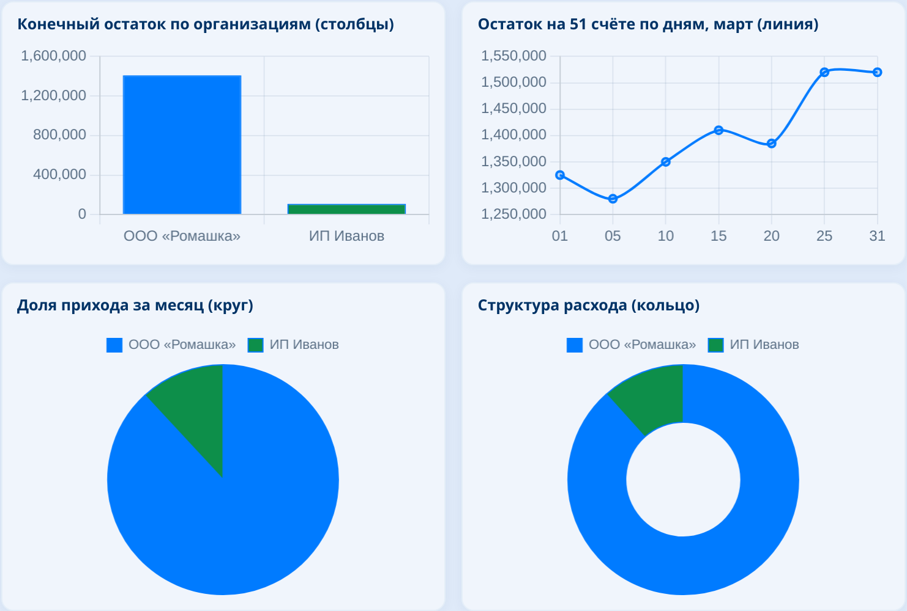
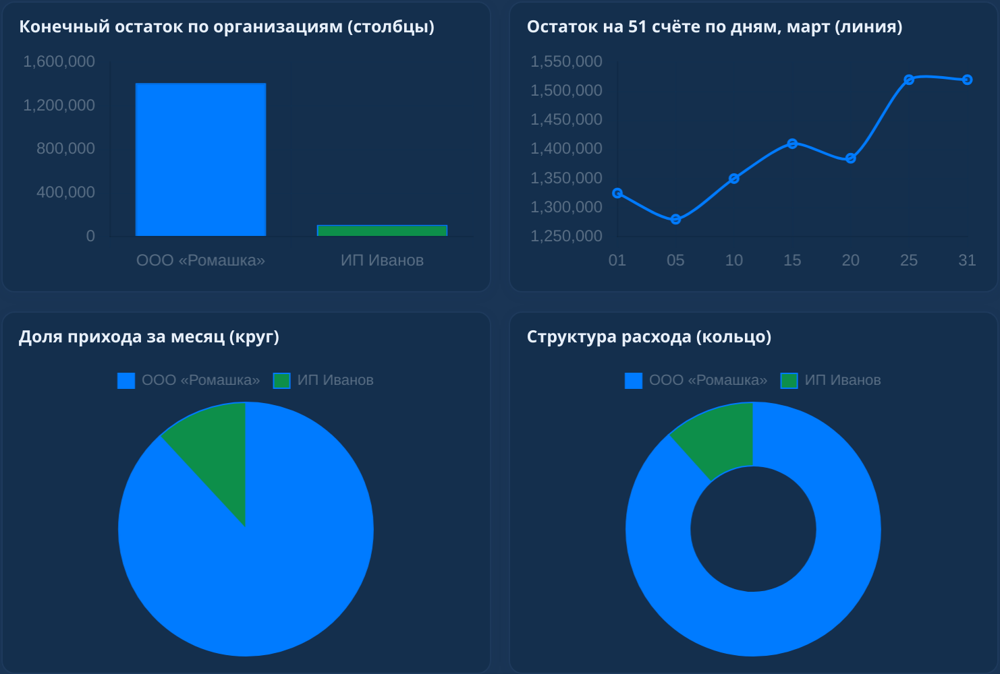
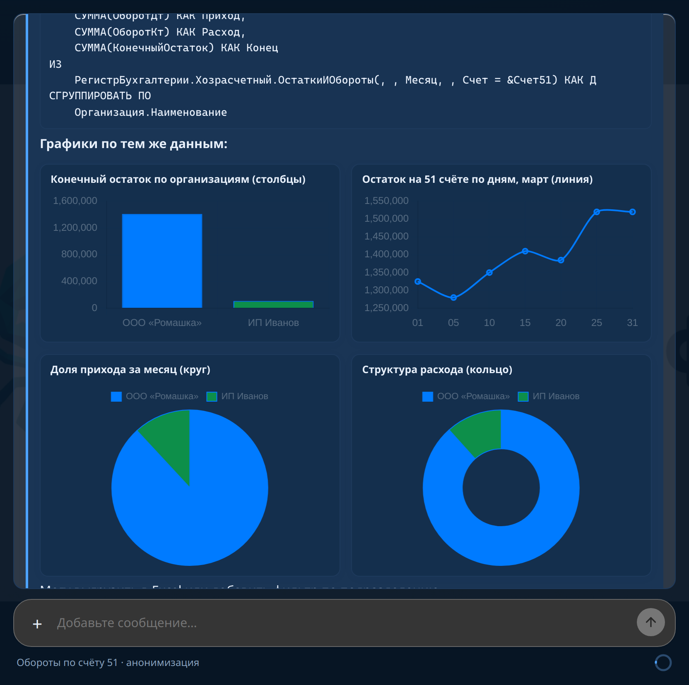

# 1СХарнесс

Чат-агент для 1С:Предприятие: диалог в стиле [крабобот](https://github.com/andretisch/krabobot), инструменты сеанса через DOM-мост обработки, LLM — OpenAI-compatible API (по умолчанию Ollama Cloud).

Главный сценарий для **вопросов по данным базы** — один вызов **`explore_data`**: внутри 1С работает субагент (метаданные, запросы), в чат возвращается только краткий **summary** и trace. Опирается на карту **`data/map.md`**, которую база собирает сама при первом диалоге.

## Что в репозитории

| Путь | Назначение |
|------|------------|
| [`index.html`](index.html) | UI чата (стили и скрипты внутри) |
| [`epf/1CHarness.epf`](epf/1CHarness.epf) | Внешняя обработка для 1С (тот же HTML в макете) |
| [`src/CHarness1C`](src/CHarness1C) | Исходники обработки; сборка: [`scripts/build-epf.sh`](scripts/build-epf.sh) |
| [`workspace/`](workspace) | `config.json`, агенты, навыки; сессии и `data/map.md` в git не хранятся |

Рабочая область на диске VM/агента: **`/workspace/workspace`**. На чужой конфигурации (не «ХарнессТест») учебные документы и самопроверка среза **не создаются**.

## Быстрый старт в 1С

1. Откройте [`epf/1CHarness.epf`](epf/1CHarness.epf) в своей базе. На предупреждении о небезопасных действиях — **Да**.
2. **Новый диалог**: если нет `data/map.md` для этой конфигурации, в чате предложат построить карту — **Да** / **Нет**. Сборка — субагент по [`skills/config-map.md`](workspace/skills/config-map.md).
3. **Настройки → Подключение**: `https://ollama.com/v1`, модель `gemma4:31b-cloud`, **API Key** Ollama Cloud → пишется в `workspace/config.json`. Альтернатива: файл **`workspace/llm-api-key.local`** (одна строка, не в git) — подхватывается при старте страницы в 1С.
4. Enter — отправить сообщение; Shift+Enter — новая строка.

Для тестового среза **ХарнессТест** при первом открытии создаются номенклатура, цены и проведённая накладная (оборот продаж **2 980**).

## Карта данных и субагент

- **`data/map.md`** — Markdown (frontmatter + Topics / Objects / Flows), **не коммитится**; создаётся в базе.
- **`explore_data`** — предпочтительный инструмент для остатков, сумм, долгов, оборотов.
- Прямые цепочки `run_query` / `inspect_metadata` в основном чате — только если пользователь явно просит инструмент.

## Графики в ответе

Инструмент **`draw_chart`** (bar, line, pie, doughnut, hbar) вставляет интерактивные превью Chart.js в пузырь ответа — удобно после `run_query` или отчёта.

Скриншоты — **окно 1С:Предприятие** с обработкой 1СХарнесс (не отдельный браузер):

Переснять: положите демо-сеанс в `workspace/sessions/readme-charts-demo.json`, откройте обработку и выполните [`scripts/capture-chart-screenshots-1c.sh`](scripts/capture-chart-screenshots-1c.sh) (нужны `DISPLAY`, `xdotool`, ImageMagick). В браузере без 1С: `index.html?demo=fresh`.

## Анонимизация и интерфейс

Чекбокс **«Анонимизировать перед отправкой в LLM»** (`connection.anonymize` в `config.json`): ИНН, телефоны, почта и названия организаций заменяются метками до запроса и восстанавливаются в ответе.

Палитры: **Крабобот (синий)** и **1С Такси (шахматка)**.

## Инструменты сеанса

- `explore_data` — субагент данных (метаданные + запросы), карта `data/map.md`
- `run_query`, `inspect_metadata`, `read_object`, `make_navlink`
- `sketch_query`, `delegate_task` — эскиз и выборка в `workspace/data`
- `report_describe`, `report_run`, `report_compose` — отчёт продаж (срез «ХарнессТест»)
- `open_draft` — форма нового документа без записи
- `fs_read`, `fs_write`, `fs_list`, `fs_search` — файлы workspace
- `session_now`, `calc`, `find_in_chat`, `find_skill`, `draw_chart`

Скриншоты отдельных инструментов: [`docs/images/tools/`](docs/images/tools/).
