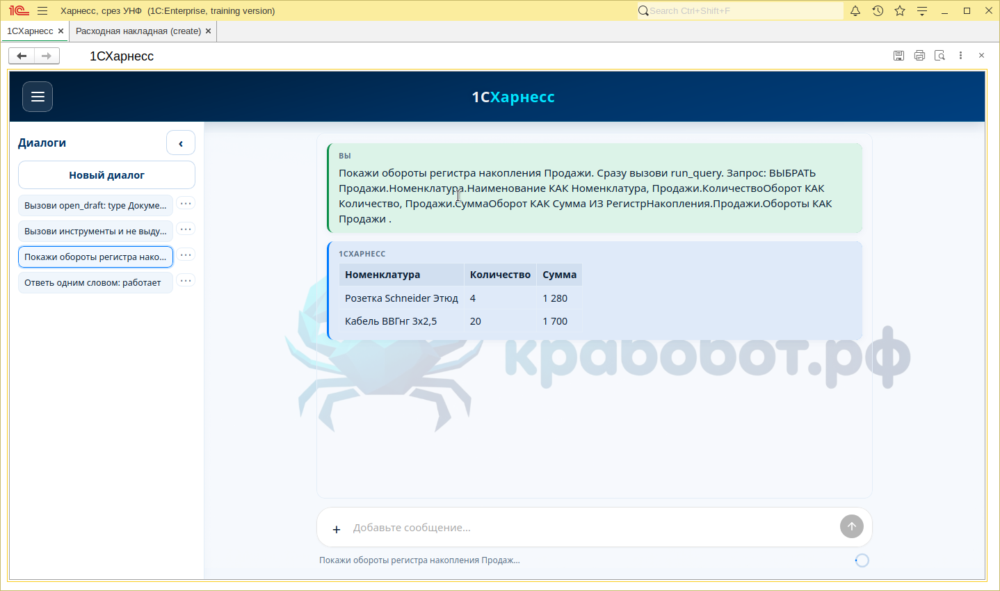
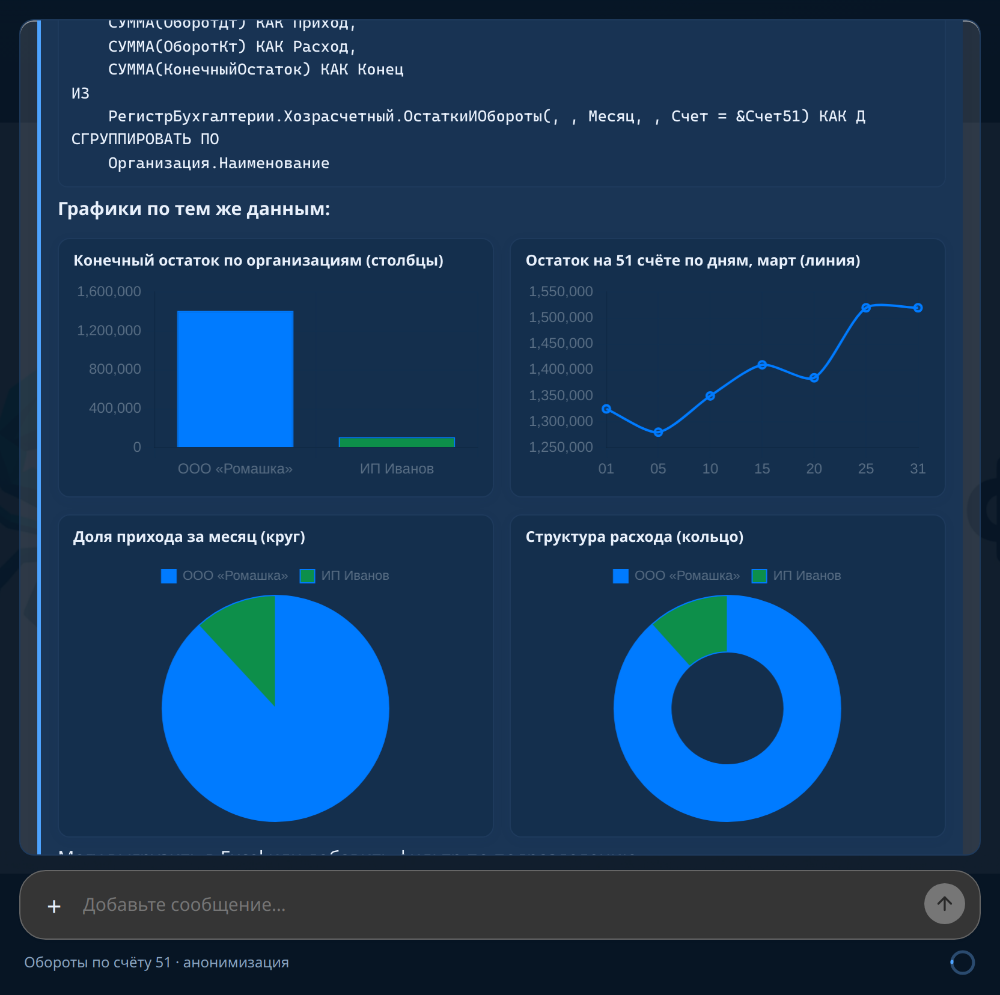
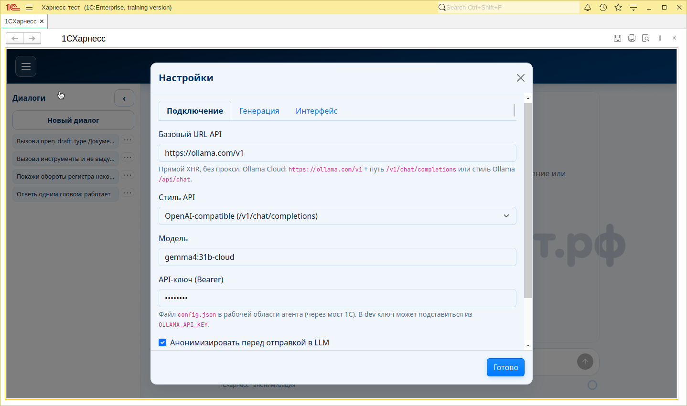
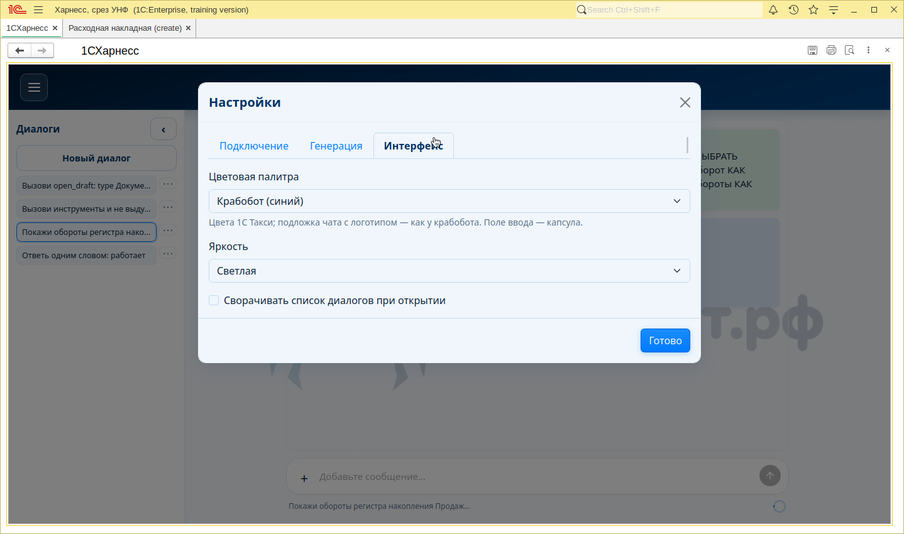
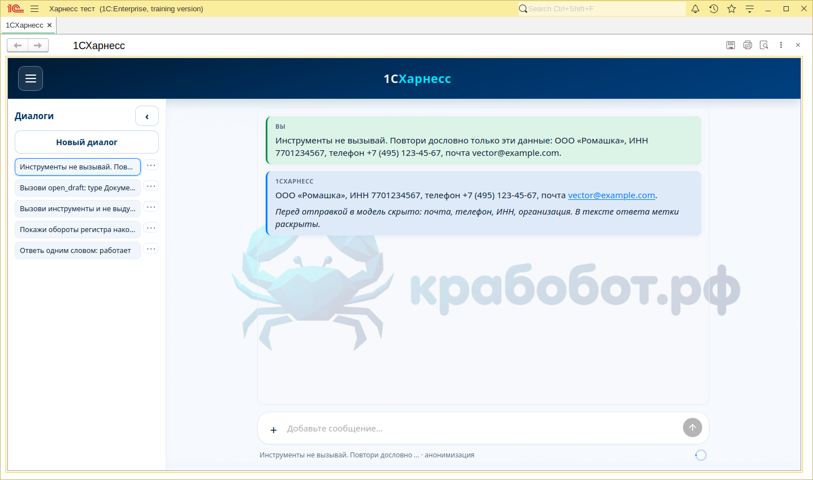
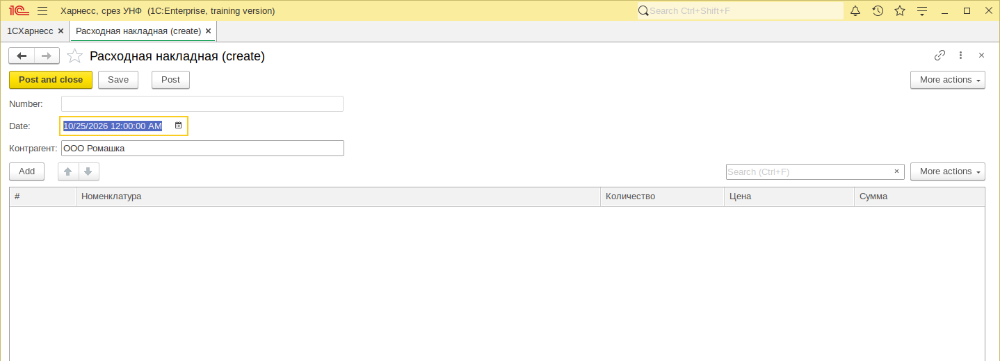
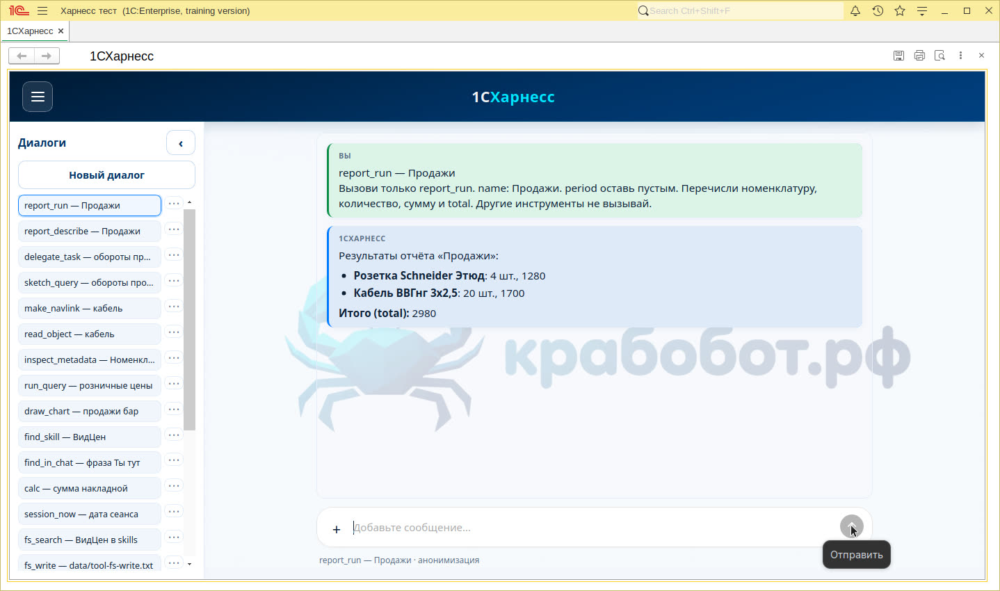
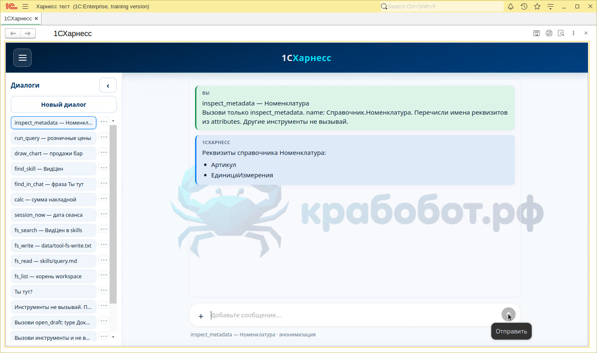

# «Я построю свой 1С-харнесс с куртизанками и посьянсом»: как я посадил LLM прямо в сеанс 1С

**КДПВ:** чат в поле HTML обработки, модель ходит в облако напрямую, а инструменты (`run_query`, навигация `e1cib`, отчёты) выполняются в **вашем** сеансе — без выдуманных цифр из головы GPT.

> **Бендер, будь он неладен:** «Ладно. Я построю свой 1С-харнесс. С куртизанками и посьянсом!»  
> Посьянсов в релизе пока нет. Зато есть рабочий чат, запросы к базе и кнопка «Открыть в 1С».

**Хабы:** `1С`, `llm`, `openai`, `ии`, `skd`, `erp`

---

## Зачем это вообще

Я устал от сценария «скопируйте ТЗ в ChatGPT и надеетесь, что он угадает структуру **вашей** УНФ». Модель не знает, есть ли у вас `РегистрНакопления.Запасы` или только учебный срез с розетками на 2 980 ₽. Она придумает — и будет уверена.

Мне нужен был агент **внутри платформы**:

- ответы опираются на **живые** выборки и метаданные;
- ссылки из чата открывают документы в **родном** окне 1С;
- настройки и ключ API лежат в **workspace** рядом с агентами и навыками — как у нормального «крабобота», только для 1С.

Отсюда название: **1CHarness** — внешняя обработка `.epf` с вложенным HTML-чатом и мостом `tool.invoke` в BSL.

## Что получилось

Коротко:

| Слой | Что делает |
|------|------------|
| `index.html` в макете | UI, Chart.js, вызовы LLM (XHR на OpenAI-compatible API) |
| Мост DOM | JSON `tool.invoke` ↔ сервер формы |
| `workspace/` | `config.json`, агенты `*.md`, сессии, карта `data/map.md` |
| Инструменты 1С | Запросы, объекты, отчёты, черновики, `report_compose` |

LLM **не** проходит через отдельный Python-мост для чата в продакшен-сценарии: в 1С чат живёт в `ПолеHTMLДокумента`, платформа сама ходит в Ollama Cloud / совместимый endpoint. Для разработки UI есть `stub-1c-platform.js` и `scripts/harness_dev.py` — чтобы крутить верстку без дизайнера.

```
Пользователь → чат (HTML)
       ↓                    ↗ LLM API (облако)
  tool.invoke ──► BSL формы ──► база сеанса
       ↑
  tool.result (JSON)
```

## Почему именно так (и в чём выигрыш)

**1. Сеанс 1С — источник правды.**  
`explore_data` не сыпет в чат сотнями строк: внутри сеанса крутится субагент (`inspect_metadata`, `run_query`), наружу — summary. Карта `data/map.md` собирается при первом диалоге по навыку `config-map` — модель не гадает имена регистров.

**2. Один EPF — один контур поставки.**  
Исходники в `src/CHarness1C`, сборка `scripts/build-epf.sh`, в базе открываете `epf/1CHarness.epf`. После `git pull` — `update-after-pull.sh`, перезапуск формы (иначе в памяти застынет старый HTML).

**3. Инструменты, а не магия промпта.**  
Жёсткий контракт: `run_query` с `params`, `read_object` с `{type, uuid}` или `e1cib`, `make_navlink` / перехват ссылок в UI → `ПерейтиПоНавигационнойСсылке`. Модели проще ошибиться в тексте, чем пробить типизированный JSON.

**4. Жизнь пользователя в 1С.**  
`open_draft` — форма нового документа с `fill`. `report_compose` — открыть универсальный отчёт БСП с пресетом (метаданные, период, текст запроса), дальше человек сохраняет вариант в привычном UI. На учебной каркасной УНФ отчёт может отсутствовать — тогда честная ошибка, а не зависание.

**5. Что я сознательно не делал.**  
Отдельный тяжёлый middleware на Python для каждого чата в проде. Полный RAG по выгрузке без live-запросов. «Универсальный» чат без `fs_delete`, из-за которого удалённые диалоги возвращались после F5 — мы это вылечили синхроном с `workspace/sessions/*.json`.

## Как повторить у себя (инструкция)

### 1. Клонировать и обновить EPF

```bash
git clone https://github.com/andretisch/1CHarness.git
cd 1CHarness
bash scripts/build-epf.sh   # нужны 1cv8 DESIGNER и DISPLAY
```

### 2. Открыть в базе

1. Файл `epf/1CHarness.epf` → предупреждение безопасности → **Да**.
2. **Настройки → Подключение:** `https://ollama.com/v1`, модель вроде `gemma4:31b-cloud`, API Key (или `workspace/llm-api-key.local`).
3. **Новый диалог** — если нет карты, согласиться построить `data/map.md`.

### 3. Проверочные фразы

- «Что по продажам?» — ожидаем `explore_data` или запрос к регистру.
- «Открой накладную» — ссылка **Открыть в 1С** (`e1cib`).
- Удалить чат в меню ⋮ — перезапустить обработку: чат не должен воскреснуть.

### 4. Только UI (без 1С)

```bash
python3 scripts/harness_dev.py
# http://127.0.0.1:<port>/index.html
```

Enter отправляет сообщение; LLM — по `config.json`.

## Скриншоты

### Чат и выборки

  
*Ответ с цифрами из сеанса, а не из фантазии модели.*

  
*`draw_chart` встраивает Chart.js в пузырь сообщения.*

### Настройки и приватность







### Инструменты платформы







## Как это делалось (короткая хроника)

1. Свести UI крабобота в макет `Страница` с UTF-8 BOM (иначе 1С коверкает кириллицу).
2. Опрос моста на форме: `ОпросМоста` → `ВыполнитьЗапросМоста` / клиентские `open_navlink`, `open_draft`, `report_compose`.
3. Починить «вечные» чаты: `fs_delete` для `sessions/<id>.json`.
4. `read_object`: разбор `e1cib` и UUID без клиентских API на сервере.
5. `report_compose`: пресет + открытие формы отчёта (УНФ/ЗУП/БП с БСП).

Коммиты лежат в [репозитории](https://github.com/andretisch/1CHarness); актуальная ветка разработки — `main`.

## Оформление под Хабр

Если публикуете там же:

- **До ката:** проблема + один тезис «инструменты в сеансе».
- Код — блоками с подсветкой, не скриншотами IDE.
- Картинки из `docs/images/` — с подписью «что на экране».
- В конце — честное «что не сделано»: нет посьянсов, учебная УНФ без полноценного универсального отчёта.

## Итог

Я хотел не «ещё один чат», а **харнесс**: рамку, в которой LLM обязан дотрагиваться до реальной базы через инструменты. Получилось грубовато, зато честно — и расширяется одним EPF, без отдельного сервера на каждого пользователя.

**P.S.** HTML-версия этой статьи: [`article-1charness.html`](article-1charness.html) в этом же каталоге.  
**P.P.S.** Посьянсы в roadmap не заведены. Зато merge в `main` уже есть — можно форкнуть и добавить своих куртизанок в `workspace/agents/`.